# Information Architecture & Website Sitemap: MORNI SINGH'S

**Brand:** MORNI SINGH'S  
**Tagline:** *Stay, Explore, Repeat!*  
**Document Type:** Information Architecture, User Flow & Sitemap Blueprint  

---

## 1. Information Architecture Philosophy

A luxury mountain retreat website must fulfill two distinct objectives simultaneously:
1. **Atmospheric Immersion:** Spark the emotional desire for tranquility, clean air, pine forests, and fireside warmth.
2. **Frictionless Conversion:** Provide rapid clarity on villa specifications, amenities, location, accessibility, and instant booking/WhatsApp communication.

To maximize engagement and minimize navigation fatigue, we propose a **Cinematic Single-Page Application (SPA)** with modular deep-dive modals and dedicated routes for key experiences.

---

## 2. Proposed Website Sitemap

```mermaid
graph TD
    A[Home: Morni Singh's] --> B[1. Atmospheric Hero & Live Altitude Badge]
    A --> C[2. Trust Marquee & Guest Highlights]
    A --> D[3. About the Sanctuary: Vision, Mission & Spirit]
    A --> E[4. The 2BHK Villa Showcase: Suites, Living & Grounds]
    A --> F[5. Verified Amenities & Comfort Matrix]
    A --> G[6. Sensory Experiences & Outdoor Pursuits]
    A --> H[7. Farm-to-Table: Morni Singh's Greens]
    A --> I[8. Visual Gallery & Artistic Interior Works]
    A --> J[9. Guest Chronicles & Verified 4.6 Rating]
    A --> K[10. Location, Distances & Scenic Routes]
    A --> L[11. Nearby Attractions & Day Excursions]
    A --> M[12. FAQs & Essential Stay Policies]
    A --> N[13. Interactive Booking Drawer & WhatsApp Concierge]
    A --> O[14. Comprehensive Footer & Corporate PHS Credentials]

    E --> E1[Interactive Room Spec Modal]
    H --> H1[Organic Farm Story Details]
    I --> I1[Full-Screen Image Lightbox]
    N --> N1[WhatsApp Pre-Filled Inquiry Generator]
    N --> N2[Direct Tele-Concierge Link]
```

---

## 3. Detailed Page Section Blueprint

### Section 1: Cinematic Hero & Atmospheric Banner
* **Visual Anchor:** High-resolution mist-shrouded Shivalik pine mountain ridge panorama.
* **Geographic Badge:** `Bhoj Darara · Morni Hills · 1,220m Altitude · 4.5h from Delhi NCR`.
* **Primary Headline:** *"Where the Shivalik Hills Whisper Peace."*
* **Tagline & Supporting Copy:** *"Stay, Explore, Repeat! A private 2BHK hill retreat blending rustic charm with modern serenity, curated art, and endless pine horizons."*
* **Dual Action CTAs:**
  * Primary Button: `[ Reserve Private Villa ]` (opens booking inquiry)
  * Secondary Button: `[ WhatsApp Concierge ]` (instant chat)

### Section 2: Trust & Guest Highlights Marquee
* Continuous smooth ticker showcasing verified proof points:
  * ★ 4.6 / 5.0 Guest Satisfaction Rating
  * Nearest Hill Station to Delhi NCR & Chandigarh
  * Exclusive Entire 2BHK Private Villa Estate
  * Private Bonfire Pit & Mountain-Facing Lawn
  * Pet-Friendly Sanctuary
  * Sister Organic Farm: Morni Singh's Greens

### Section 3: The Sanctuary & Philosophy (About Morni Singh's)
* **Narrative:** Introducing Morni Singh's as an intimate unit of Pratham Hospitality Services Pvt. Ltd. (PHS).
* **The Four Pillars:**
  * *Vision:* To be the most cherished homestay in the hills.
  * *Mission:* To provide a serene and cozy retreat filled with warmth, care, and unforgettable memories.
  * *Action:* Blending rustic charm with modern comfort for an effortless stay.
  * *Passion:* Infusing every detail with love, care, and comfort.
* **Art & Culture Showcase:** Celebrating the curated original paintings and photography that grace every room.

### Section 4: The 2BHK Villa Showcase (Interactive Space Explorer)
* **Overview Metrics:** 2 Master Bedrooms · 2 Bathrooms · Living Lounge · Private Kitchenette · Garden Lawn & Terrace · Up to 6–10 Guests.
* **Interactive Space Tabs:**
  1. *Master Bedroom Suite:* King bed, hill-view panoramic window, premium linens, heating/AC.
  2. *Second Bedroom Suite:* Comfortable double bed, garden vista, peaceful ambiance.
  3. *Artistic Living Lounge:* Plush seating, handpicked paintings, reading corner, dining table.
  4. *Equipped Kitchenette:* Refrigerator, microwave, tea/coffee station, cookware.
  5. *Terrace & Private Lawn:* Outdoor seating, morning yoga deck, sunset viewing perch.

### Section 5: Verified Amenities & Comfort Grid
Categorized for rapid scanning:
* **The Living Space:** Mountain view balcony, private terrace, expansive lawn, artistic interior styling, work/writing desk.
* **Climate & Comfort:** Air conditioning, winter heating provision, fresh linens, hot water geysers.
* **Dining & Kitchen:** Refrigerator, microwave, kitchenware, caretaker meal assistance, outdoor BBQ grill setup.
* **Outdoor & Wildlife:** Private bonfire pit, stargazing lawn, birdwatching area, pet-welcoming grounds.
* **Logistics & Safety:** Free private on-site parking, secure private perimeter, caretaker on premises.

### Section 6: Sensory Experiences & Mountain Pursuits
* **Evening Bonfires Under the Stars:** Crackling pine wood, warm blankets, barbecue, and storytelling.
* **Misty Morning Yoga & Meditation:** Serene lawn facing the rolling Shivalik ridges.
* **Birdwatching & Forest Trails:** Exploring local Himalayan birds and wild medicinal herbs.
* **Art & Literature Solitude:** Unplugging with books and artistic introspection.

### Section 7: Farm-to-Table: Morni Singh's Greens
* Highlighting the sister agricultural project of Morni Singh's:
  * Zero-pesticide, regenerative cultivation.
  * Pure Shivalik ginger, turmeric, garlic, green chillies, and fresh coriander.
  * Bringing wholesome, farm-fresh goodness directly to guest plates.

### Section 8: Visual Gallery & Lightbox
* Responsive masonry grid showcasing:
  * Villa facade & architecture
  * Bedroom interiors & plush bedding
  * Golden hour across the Shivalik hills
  * Evening bonfire setup
  * Organic farm harvests at Morni Greens
  * High-res modal lightbox with zoom and keyboard navigation.

### Section 9: Guest Chronicles & Social Proof
* Verified guest feedback highlights:
  * "A peaceful slice of heaven just an hour from Chandigarh. The views and privacy are unparalleled."
  * "Our dog loved the open garden, and the evening bonfire was magical. The caretaker took wonderful care of us."
  * "Tastefully decorated with authentic art and paintings. You feel like you are staying in a loving home, not a commercial hotel."

### Section 10: Location, Connectivity & Getting There
* **Exact Coordinates & Address:** Bhoj Darara, Morni Hills, Haryana 134205.
* **Interactive Travel Cards:**
  * *From Delhi NCR:* ~255 km / 4.5–5 hours via NH44 & Himalayan Expressway.
  * *From Chandigarh:* ~42 km / 1 hour 15 mins via Panchkula.
  * *From Panchkula:* ~35 km / 55 mins scenic hill climb.
  * *From Chandigarh Airport (IXC):* ~50 km / 1.5 hours.
  * *From Kalka Station:* ~40 km / 1 hour 15 mins.
* Embedded responsive map preview with direct "Open in Google Maps" link.

### Section 11: Nearby Attractions & Excursions
* **Tikkar Taal Twin Lakes (18 mins):** Boating, lakeside photography, calm waters.
* **Morni Fort (15 mins):** Historic hill fortress with 360-degree vistas.
* **Adventure Park (15 mins):** Ziplining and rope bridges for adventure seekers.
* **Pinjore Gardens / Yadavindra Gardens (45 mins):** Mughal terraced gardens.

### Section 12: Frequently Asked Questions (FAQ)
Categorized accordion answering common traveler questions:
* *Booking & Villa Privacy:* Whole-villa exclusivity vs per-room availability.
* *Check-in/Check-out Times:* 2:00 PM check-in, 11:00 AM check-out.
* *Food & Meals:* Kitchen usage, caretaker assistance, dhaba orders.
* *Pet Policy:* Welcoming dogs and family pets.
* *Wi-Fi & Mobile Connectivity:* 4G/5G mobile signals, relaxing digital detox.
* *Road Conditions & Drive:* Smooth scenic paved mountain road suitable for all cars.

### Section 13: Instant Booking Drawer & Pre-Filled WhatsApp Concierge
* Date selector (Check-in / Check-out).
* Guest selector (Adults, Children, Pets).
* Instant WhatsApp generator that constructs:
  > *"Hello Morni Singh's team! I would like to inquire about reserving the 2BHK Villa for [X] guests from [Check-in Date] to [Check-out Date]. Please share availability and tariff details."*
* Direct click-to-call telephone option (`+91-966-779-8451`).

### Section 14: Footer & Corporate Governance
* Property branding, Pratham Hospitality Services Pvt. Ltd. company information, corporate office address (Vasant Kunj, New Delhi), copyright, navigation links, and social connections.

---

## 4. User Journey Mapping

### User Persona A: The Burned-Out Delhi NCR Professional
* **Trigger:** Long working week in Gurgaon/Noida; needs an emergency weekend nature escape without an 8-hour drive to Manali/Shimla.
* **Journey:** Lands on Hero → sees "Nearest Hill Station from Delhi NCR (4.5h)" → reviews 2BHK Villa photos & bonfire setup → uses quick WhatsApp button to book for Friday–Sunday.

### User Persona B: The Chandigarh Family with Pets
* **Trigger:** Wants a weekend staycation with kids and their Golden Retriever where the dog has space to run freely.
* **Journey:** Scans Hero → notices "Pet-Friendly" and "Private Lawn" badges → explores Villa layout & lawn photos → reviews FAQs on pets → reserves via WhatsApp.

### User Persona C: The Creative Couple / Nature Enthusiast
* **Trigger:** Looking for serene mountain solitude to read, write, paint, or unwind together.
* **Journey:** Engages with "The Art of Tranquility" section → reads about Morni Greens organic farm-to-table meals → checks Tikkar Taal proximity → books directly.
